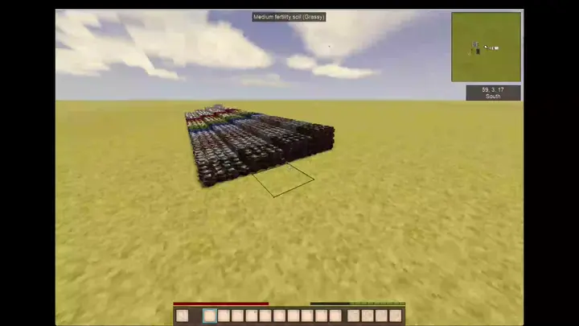

# Mineral Piles

A Vintage Story mod that expands ground-storage piles for 17 ungraded minerals and crystals from vanilla's 12-item scattered piles up to neat 64-item stacks.

## Features
- **64-item pile capacity** (up from vanilla's 12) arranged in 4 layers of 4 rows by 4 columns, with each chunk randomly rotated using a seed-based Python generator (seed: `829845863`, with automatic layer scaling for taller chunks like Alum).
- Uses standard vanilla ground-storage controls for adding to and taking from piles (1 item at a time, or up to 16 at a time with Sneak).
- Supports **17 ungraded minerals and crystals**:
  - **Quartz & Crystals:** Clear Quartz, Normal Quartz, Rose Quartz, Smoky Quartz, Amethyst
  - **Ungraded Minerals:** Alum, Borax, Cinnabar, Corundum, Fluorite, Graphite, Kernite, Olivine, Phosphorite, Rough Lapis Lazuli, Sulfur, Sylvite

## How to Use
- **Start a pile:** Hold a supported mineral and **Sneak + Right-Click** on a solid block.
- **Add to a pile: Right-Click** to place 1 item, or **Sneak + Right-Click** to place up to 16 items.
- **Take from a pile: Right-Click** with an empty hand to take 1 item, or **Sneak + Right-Click** to take up to 16 items.

## Installation
> **Note:** Tested on Windows only for now (standard JSON content mod, so Linux/macOS should work as well).

1. Download `MineralPiles.zip` (do not extract it).
2. Move it into your Vintage Story `Mods` folder:
   - **Windows:** `%AppData%\VintagestoryData\Mods`
3. Launch Vintage Story and enable **Mineral Piles** in the Mod Manager.